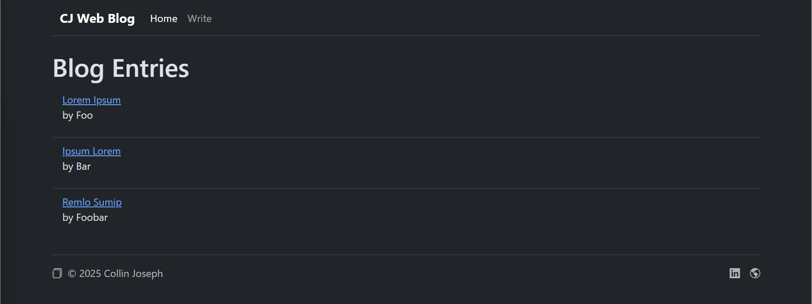
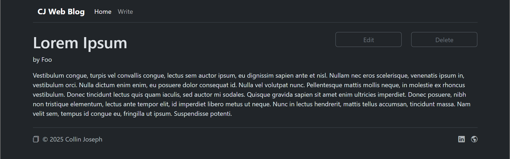
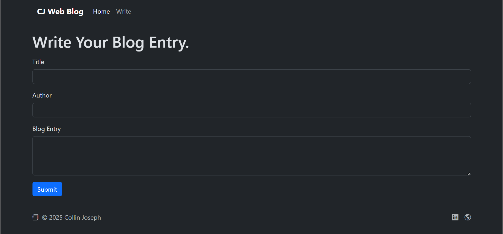
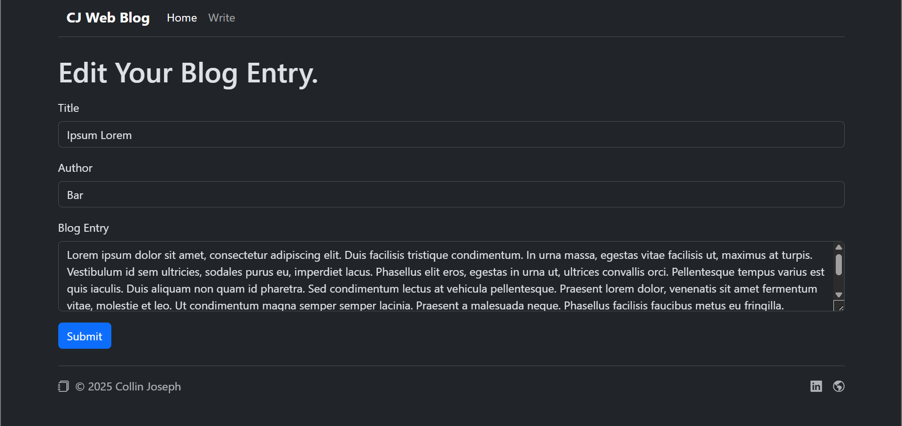

# CJ Web Blog

**Author**: Collin Joseph<br>
**Stack**: `HTML, EJS, CSS, Bootstrap, jQuery, Node.js, Express.js, SQLite`<br>
**Description**: A blog hosting website. Users can: create, read, update and delete (**CRUD**) blog entries.

## Data storage

Blog entries are stored in a SQLite database (`blog.db`). The app creates the
database and the `entries` table automatically on startup.

To import the entries from the original `blogEntries.json` file:

```sh
npm install
npm run migrate
```

`blogEntries.json` is kept as a seed/backup and is not read at runtime. The
migration preserves the original array indexes as entry IDs, so existing
`/read?id=N` links keep working. If `blog.db` already contains entries, the
migration refuses to run unless you pass `--force`:

```sh
npm run migrate -- --force
```

## Development

```sh
npm start   # start the server at http://localhost:3000
npm test    # run the automated test suite
```

## Screenshots


**Figure 1.** *Blog Homepage*
<br/><br/>


**Figure 2.** *Read/View Page*
<br/><br/>


**Figure 3.** *Write/Create Page*
<br/><br/>


**Figure 4.** *Edit Page*
<br/><br/>

<hr>
Collin Joseph, 2025
